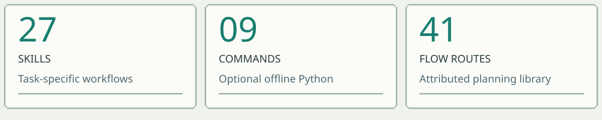

<details>
<summary>
<picture>
  <source media="(max-width: 540px) and (prefers-color-scheme: dark)" srcset="assets/readme/banner-mobile-dark.svg" />
  <source media="(max-width: 540px) and (prefers-color-scheme: light)" srcset="assets/readme/banner-mobile-light.svg" />
  <source media="(prefers-color-scheme: dark)" srcset="assets/readme/banner-dark.svg" />
  <source media="(prefers-color-scheme: light)" srcset="assets/readme/banner-light.svg" />
  
</picture>
</summary>

<picture>
  <source media="(max-width: 540px) and (prefers-color-scheme: dark)" srcset="assets/readme/quest-menu-mobile-dark.svg" />
  <source media="(max-width: 540px) and (prefers-color-scheme: light)" srcset="assets/readme/quest-menu-mobile-light.svg" />
  <source media="(prefers-color-scheme: dark)" srcset="assets/readme/quest-menu-header-dark.svg" />
  <source media="(prefers-color-scheme: light)" srcset="assets/readme/quest-menu-header-light.svg" />
  
</picture>

<p align="center">
  <a href="#quest-01-inspect-a-page"></a>
  <a href="#quest-02-brief-a-writer"></a>
  <a href="#quest-03-read-a-search-console-export"></a>
</p>

**Choose your path:** [Inspect a page](#quest-01-inspect-a-page) · [Plan a brief](#quest-02-brief-a-writer) · [Decode an export](#quest-03-read-a-search-console-export)

New here? [Install SEO-pro first](#quick-start).

Open a quest, copy its prompt, and bring your evidence to ChatGPT.

</details>

# chatgpt-seo

**Turn a page, draft, or SEO export into a sourced fix plan inside ChatGPT.**

SEO-pro by Daniel Agrici brings focused SEO workflows to the conversation: inspect the evidence, explain the problem, and give you a change you can check.

**Your loadout**

<a href="docs/CAPABILITIES.md"></a>
<a href="NOTICE.md"></a>

<p align="center">
  <a href="#quick-start"></a>
  <a href="#choose-your-quest"></a>
  <a href="docs/INSTALL.md"></a>
</p>

**Status:** manual ZIP installation. Public directory submission and approval are pending. This is an independent plugin, not made or endorsed by OpenAI.

## Quick start

1. [Download SEO-pro 0.2.14](downloads/ai-marketing-hub-seo-0.2.14.zip), then choose **View raw** on GitHub's file page. Use this plugin ZIP, not GitHub's source-code ZIP.
2. In ChatGPT, open **Plugins**, choose **Add**, then **Upload plugin archive**. Upload the ZIP and choose **Add plugin**.
3. Open the plugin's settings and choose **Install plugin**.
4. Choose **Try in chat**, or start a new chat with **SEO-pro** selected.
5. Paste a public page URL or attach a draft/export, then ask one of the questions below.

The upload option and available tools depend on your ChatGPT account and workspace. If the option is unavailable, see [installation help](docs/INSTALL.md). Downloading this repository does not install the plugin. No separate SEO account, API key, or Google connection is required.

## Choose your quest

Start with what you have. Open a card for a copyable prompt and the response structure to request.

### Quest 01: Inspect a page

<details>
<summary>
<picture>
  <source media="(prefers-color-scheme: dark)" srcset="assets/readme/quest-inspect-dark.svg" />
  <source media="(prefers-color-scheme: light)" srcset="assets/readme/quest-inspect-light.svg" />
  
</picture>
</summary>

**Ask ChatGPT:**

```text
Review this page for SEO: [paste your page URL]. Show the
evidence, prioritize the fixes, and draft a better title and
description using only facts on the page. For each fix, tell
me how to verify the change.
```

**You leave with:** a page diagnosis, supported metadata options, and checks for each recommended change. If the page cannot be opened, supply its HTML or text.

**Response structure:** evidence observed, finding, proposed change, verification, and anything still unknown.

[Read the page workflow](plugins/ai-marketing-hub-seo/skills/seo-page/SKILL.md)

</details>

### Quest 02: Brief a writer

<details>
<summary>
<picture>
  <source media="(prefers-color-scheme: dark)" srcset="assets/readme/quest-brief-dark.svg" />
  <source media="(prefers-color-scheme: light)" srcset="assets/readme/quest-brief-light.svg" />
  
</picture>
</summary>

**Ask ChatGPT:**

```text
Create an SEO content brief about [topic] for [audience].
Include the search intent, outline, facts we need to source,
and useful internal links from my site: [site or URL list].
Label ideas that lack measured search data as planning
assumptions.
```

**You leave with:** a writer-ready brief, an outline, and evidence requirements. No invented search volumes or claims about the audience.

**Response structure:** audience and intent, page purpose, outline, source checklist, internal links, and review criteria.

[Read the brief workflow](plugins/ai-marketing-hub-seo/skills/seo-content-brief/SKILL.md)

</details>

### Quest 03: Read a Search Console export

<details>
<summary>
<picture>
  <source media="(prefers-color-scheme: dark)" srcset="assets/readme/quest-export-dark.svg" />
  <source media="(prefers-color-scheme: light)" srcset="assets/readme/quest-export-light.svg" />
  
</picture>
</summary>

**Ask ChatGPT:**

```text
Analyze this Search Console CSV for [date range]. Find pages
worth reviewing and explain clicks and CTR. Check the
columns and date coverage before calculating anything. Flag
missing context before drawing conclusions.
```

**You leave with:** calculations for the supplied rows, supported page/query opportunities, and the next checks. An export does not grant live account access.

**Response structure:** coverage, calculations, opportunities, limitations, and the evidence needed next.

[Read the search-data workflow](plugins/ai-marketing-hub-seo/skills/seo-google/SKILL.md)

</details>

## Skill tree

<details>
<summary>
<picture>
  <source media="(prefers-color-scheme: dark)" srcset="assets/readme/loadout-dark.svg" />
  <source media="(prefers-color-scheme: light)" srcset="assets/readme/loadout-light.svg" />
  
</picture>
</summary>

<picture>
  <source media="(prefers-color-scheme: dark)" srcset="assets/readme/loadout-open-dark.svg" />
  <source media="(prefers-color-scheme: light)" srcset="assets/readme/loadout-open-light.svg" />
  
</picture>

- **Skills:** [All 27 workflows](docs/CAPABILITIES.md), selected for your task.
- **Commands:** [Nine Python entrypoints](plugins/ai-marketing-hub-seo/references/runtime-and-data.md) for files you provide, when execution is available.
- **References and templates:** [Decision packs](plugins/ai-marketing-hub-seo/references) and [report formats](plugins/ai-marketing-hub-seo/assets/audit-template.md).
- **FLOW:** [41 attributed routes](plugins/ai-marketing-hub-seo/skills/seo-flow/SKILL.md) for organizing an initiative.

</details>

Choose a branch to see the workflow behind it.

| Bring | Get back |
| --- | --- |
| A [site or page](plugins/ai-marketing-hub-seo/skills/seo-audit/SKILL.md) | Evidence, prioritized fixes, and verification steps |
| [Technical evidence](plugins/ai-marketing-hub-seo/skills/seo-technical/SKILL.md) | Crawl, canonical, index-control, and rendering findings |
| A [draft or topic](plugins/ai-marketing-hub-seo/skills/seo-content-brief/SKILL.md) | Content review, briefs, or sourced comparison drafts |
| [Markup](plugins/ai-marketing-hub-seo/skills/seo-schema/SKILL.md), [XML](plugins/ai-marketing-hub-seo/skills/seo-sitemap/SKILL.md), or [locale URLs](plugins/ai-marketing-hub-seo/skills/seo-hreflang/SKILL.md) | Structured-data, sitemap, or hreflang checks and drafts |
| [Search data](plugins/ai-marketing-hub-seo/skills/seo-google/SKILL.md), [links](plugins/ai-marketing-hub-seo/skills/seo-backlinks/SKILL.md), or [Maps exports](plugins/ai-marketing-hub-seo/skills/seo-maps/SKILL.md) | Analysis scoped to the supplied data |
| [Business](plugins/ai-marketing-hub-seo/skills/seo-local/SKILL.md) or [product pages](plugins/ai-marketing-hub-seo/skills/seo-ecommerce/SKILL.md) | Local or ecommerce recommendations from real facts |
| [Keywords](plugins/ai-marketing-hub-seo/skills/seo-cluster/SKILL.md) or a [business goal](plugins/ai-marketing-hub-seo/skills/seo-plan/SKILL.md) | Page targets, internal links, and a practical roadmap |
| [AI-search](plugins/ai-marketing-hub-seo/skills/seo-geo/SKILL.md) or [agent-readiness evidence](plugins/ai-marketing-hub-seo/skills/seo-agentic/SKILL.md) | Access, usefulness, and task-completion checks |
| [Before/after snapshots](plugins/ai-marketing-hub-seo/skills/seo-drift/SKILL.md) | Observable changes and a regression-check plan |
| An [image request](plugins/ai-marketing-hub-seo/skills/seo-image-gen/SKILL.md) | Requested visuals through ChatGPT's integrated image tool, when available |

The [full capability map](docs/CAPABILITIES.md) covers all 27 skills, including FLOW, search experience, programmatic pages, image review, and implementation handoffs. These are workflows, not 27 external API tools.

## What happens in ChatGPT

You choose a task and its evidence. ChatGPT loads the relevant skill and supporting references, uses the tools available in that chat, and connects each finding to a fix and a verification step.

Public browsing can inspect accessible pages. Account analysis uses your exports or a separately authorized read tool. Nine bundled Python commands can inspect selected HTML, XML, CSV, JSON, and image headers when file execution is available. They use Python's standard library and do not fetch URLs. Without execution, the workflow explains which checks it could perform manually.

The plugin includes no hosted MCP server, OAuth client, crawler installation, recurring monitor, or paid data integration. It cannot guarantee rankings, traffic, indexing, rich results, or AI citations. Missing evidence stays unknown.

## Your data

The package has no publisher-operated server or telemetry. It does not send your task inputs or results to Daniel Agrici. ChatGPT and tools you authorize process data under their own settings and policies. Files may remain in your chat or workspace.

Share only the material the task needs. Remove credentials and unrelated personal information from exports. GitHub issues are public: use a small, redacted example for support.

Read the [privacy statement](plugins/ai-marketing-hub-seo/legal/PRIVACY.md) and [usage terms](plugins/ai-marketing-hub-seo/legal/TERMS.md).

## Field guide

<details>
<summary><strong>Is this the old Codex SEO suite?</strong></summary>

This repository is being repurposed for the already-built ChatGPT package. The former Codex implementation is a separate product; its installers, hooks, agents, and provider integrations are not bundled here. See the [transition notes](docs/TRANSITION.md) before changing an existing installation.

</details>

<details>
<summary><strong>Do I need Python or an API key?</strong></summary>

Normal ChatGPT use requires no local Python setup or API key. The optional offline commands need Python 3.10 or newer in an execution-capable host. Image creation needs the host's integrated image tool. Unavailable capabilities are reported rather than simulated.

</details>

<details>
<summary><strong>Can it read my Google accounts?</strong></summary>

No Google connection is included. Upload an export, or explicitly authorize a suitable read tool already available in your chat. Never paste an authentication token or password.

</details>

<details>
<summary><strong>Does a schema check mean I qualify for rich results?</strong></summary>

No. JSON syntax, visible-fact agreement, Schema.org validity, and Google's eligibility requirements are separate checks. The report states which ones were actually verified.

</details>

<details>
<summary><strong>Can it publish fixes or contact someone for me?</strong></summary>

It can prepare requested code, drafts, and implementation briefs. Publishing, account changes, and sending require appropriate tools and explicit authorization. No lead form or contact tool is included.

</details>

<details>
<summary><strong>What has been tested?</strong></summary>

The repository includes file-based regression tests and deterministic package validation. Earlier private-host tests have separate versioned evidence. Neither establishes public directory approval or identical behavior on every ChatGPT surface. See [verification and release status](docs/VERIFICATION.md).

</details>

## Support and development

Use [Support](SUPPORT.md) for installation questions, bugs, and privacy questions. For changes to the package, start with [Contributing](CONTRIBUTING.md). The public source and license permit you to inspect and adapt it without joining a community or following a publisher link.

Publisher community: [AI Marketing Hub Pro](https://www.skool.com/ai-marketing-hub-pro).

<a href="https://www.skool.com/ai-marketing-hub-pro"></a>

## License and attribution

[MIT](LICENSE) applies to the code and workflows except the attributed FLOW material, which uses [CC BY 4.0](https://creativecommons.org/licenses/by/4.0/). Read [NOTICE](NOTICE.md) for the boundary and logo rights.

Adapted from the public [Claude SEO](https://github.com/AgriciDaniel/claude-seo) project at its recorded commit. [Provenance](plugins/ai-marketing-hub-seo/provenance.json) retains the source and adaptation details. No private Pro source is included.
